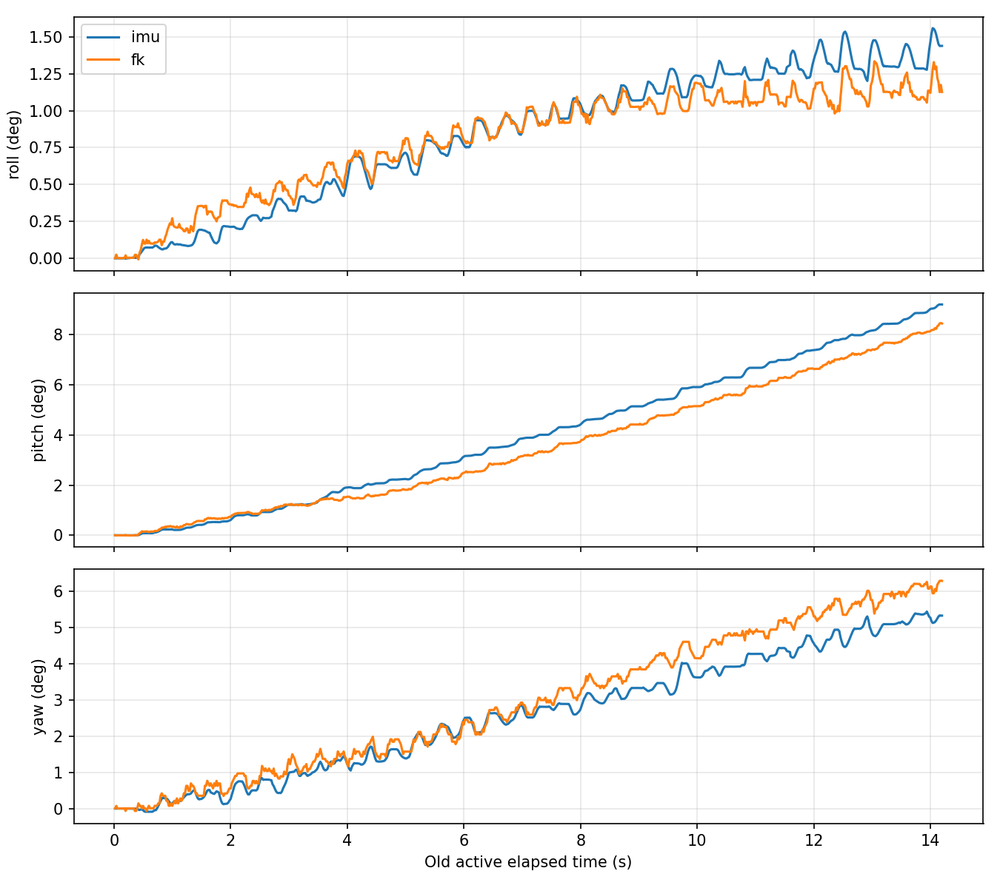
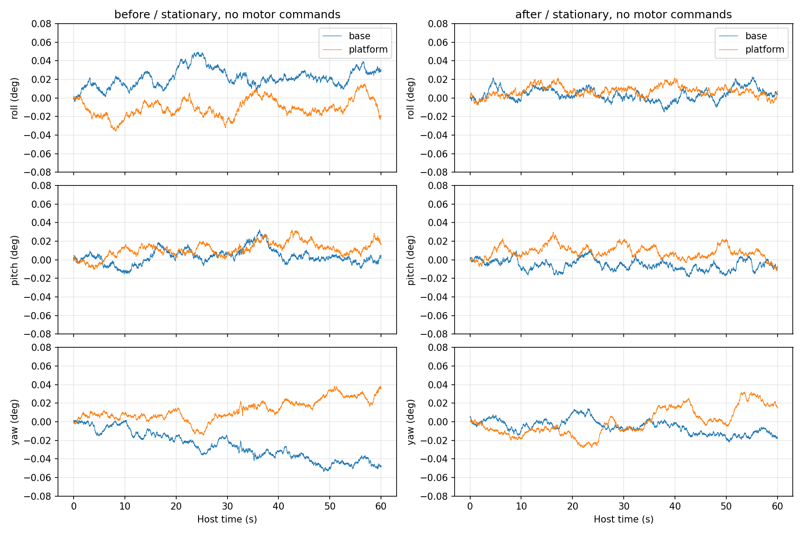

# 双 IMU 漂移诊断与修正（2026-11-05）

工程：Torque。Position只读参考；本轮没有运行电机控制，**hardware_write_count=0**。原始输入 `results/force_position/20261105-125125/` 不修改。此报告区分历史真实闭环、当前真实静止采集和离线反事实重放。

## 主要根因：失效力参考驱动了真实平台漂移

历史运行有效姿态段14.198秒，Base的Roll/Pitch/Yaw变化为 `[-0.00834,-0.06572,+0.00109]°`；Platform为 `[+1.4393,+9.2053,+5.3334]°`。用户确认六轴已装回、两IMU固定且没有人为触碰。

执行器反馈实际从HOME附近变到 `[1088,972,820,1022,998,819]` steps。按每轴真实反馈接收时间，选取不晚于Platform接收时刻的六轴反馈做FK，结合Base姿态重建世界姿态变化，最终Roll/Pitch/Yaw约 `[1.1267,8.4463,6.2935]°`。两条姿态曲线的相关系数为 `[0.9823,0.9977,0.9952]`，平均绝对差为 `[0.1062,0.5112,0.4099]°`。

因此，Platform大幅变化主要对应**真实机构运动**，不是将静止传感器积分出了9°。FK是模型交叉验证，不是外部姿态真值；模型/安装/时延仍解释不了的差值不能写成零。

直接的软件原因是沿用了10月31日的软件相对力参考：

```
raw_zero = [3520.0677, -277.9950, -6214.2757, 672, -1125.2256, -6885.7845]
本轮初始反馈 = [-445, 93, 100, 672, -490, -153]
偏差(relative_raw) = [-3965.07,370.99,6314.28,0,635.23,6732.78]
```

原有PID增益Ki=0，并不意味着没有积分：控制器另外执行了
`correction_dot = A * (F_cmd - F_relative)` 的积分导纳。已有命令力范围只有约±50.986 relative_raw，而反馈偏差高达数千，积分导纳持续产生位移修正。历史末次修正为 `[+2.7874,-0.2539,-4.3856,-0.0053,-0.4159,-4.6755] mm`，方向和电机运动一致。过去的硬件Tare、重装或载荷变化都会使旧参考不再适用；本次记录本身不能唯一追溯零点为何改变，但可以确认旧参考与本次状态不匹配且已进入了控制计算。

## IMU 数据链检查

- H30节点以 `O_RDONLY` 打开IMU串口，不向传感器写校准/复位命令。数据来自厂家输出的已融合四元数；Torque没有重新积分陀螺仪生成姿态。
- 原始协议四元数按 `qw,qx,qy,qz` 解码，ROS/研究代码使用 `x,y,z,w`，归一化与乘法顺序一致。`q_relative = conjugate(q_reference) * q_current`。
- 当前Position J14 `feedforward_pd` 实际使用 `J11M2PidResidualRunner`。这条已验证路径对Base和Platform都使用 `Rz(+90°) R_relative Rz(-90°)`，Torque复用了同一实现。部分更早的Position通用runner包含其它安装约定，不能混用。本次保留已验证J14-M2变换，没有修改安装矩阵或符号。
- Base构造 `R_WB`，前馈 `R_BP_FF=R_WB.T`；Platform构造 `R_WP`；世界误差 `Log(I*R_WP.T)`；用Position原有SO(3)函数将世界残差变换到Base并合成。没有重复Z90变换或欧拉角累加。
- 陀螺仪协议为deg/s，经驱动转换为rad/s；加速度数据本次实测约9.8 m/s²。没有将重力当作零点直接扣除，也没有对已融合四元数重复做陀螺仪均值补偿。
- 原历史文件只有50Hz姿态诊断和电机反馈，没有完整逐包IMU、陀螺仪、加速度数据，因此无法从该历史文件直接重建当时的硬件gyro bias。现在补齐原始解码消息记录。
- 两路实际消息约200Hz，控制数学约50Hz。header是主机发布时戳，不是设备采样时钟；消息可能随USB批量到达，单次最大间隔约26～36 ms。没有重复/倒退header。修正后实时诊断的两路header差中位1.849 ms、最大27.860 ms；原J14为最新值处理，并非硬件同步。本次没有引入新的IMU融合/同步架构。离线相对姿态统计用共同主机时刻Slerp，明确属于分析处理。

## 两轮真实静止验证

操作员确认两个IMU固定静止。每轮约60秒、每只约12000条有效消息，电机未接收任何写入。姿态变化统计采用首尾各1秒四元数均值，峰峰值按同一参考计算。

| 数据 | IMU | 实测频率 Hz | 首尾SO(3)变化 ° | Roll / Pitch / Yaw峰峰值 ° |
|---|---|---:|---:|---|
| 修正前静止 | base | 199.74 | 0.0568 | 0.0536 / 0.0480 / 0.0556 |
| 修正前静止 | platform | 199.77 | 0.0428 | 0.0508 / 0.0423 / 0.0530 |
| 修正后静止 | base | 199.81 | 0.0183 | 0.0380 / 0.0290 / 0.0362 |
| 修正后静止 | platform | 199.75 | 0.0202 | 0.0292 / 0.0418 / 0.0600 |

修正后的Base/Platform相对姿态变化：Roll/Pitch/Yaw峰峰值 `[0.04999,0.05206,0.08977]°`，相对SO(3)最大变化约0.05097°。这是相对于两路初始操作参考的变化，不是新的绝对安装标定。

硬件原始陀螺仪静止均值（修正后，rad/s）：

- Base `[0.0002678,0.0001154,0.0000339]`，标准差约 `[0.001000,0.000974,0.000789]`。
- Platform `[0.0011147,-0.0011278,0.0008938]`，标准差约 `[0.001022,0.000908,0.000763]`。

加速度均值：Base `[-0.40130,0.20879,9.78190] m/s²`，模长均值9.79236；Platform `[0.02472,0.03542,9.81560] m/s²`，模长均值9.81570。Base的非零水平分量包含其静止倾角，不能在没有已知姿态/六面标定时直接认定为加速度偏置。

仍存在小量表观漂移和噪声，尤其Yaw；60秒不能证明长期无漂移或确定全部磁场/温漂因素。前后原始波动属于相近量级，没有硬件写校准参数，**不能把后采数据较小归功于软件消除了传感器硬件漂移**。本次确证的是没有重现9°级静止漂移。





## 实际修正

1. `force_torque_control/imu_chain.py`：复用Position的符号一致四元数均值函数，增加一次性一秒静止操作参考；两路均要求真实唯一样本、gyro有效、角速度/姿态方差符合原Position阈值。不写传感器，不连续重设参考，不把初始姿态误称硬件零点。
2. `imu_node.py`：增加stationary模式，保留configured/first_valid兼容；保留原始四元数、gyro、accel、可用性、接收/header时间和帧名称，记录两路时戳差。PID、SO(3)、安装变换、滤波控制律未改。旧J14-M2捕获50次后取末样本；这里采用Position已有通用runner的平均与静止检查，避免单帧参考噪声。
3. `force_position_control/runtime.py`：正式入口默认采用stationary参考，直接记录逐条IMU消息。相对力参考在首个状态读完、任何Servo/运动写入之前检查是否超出现有相对力命令范围；失配时明确拒绝，不自动抹掉载荷。
4. `uart_driver.py`：初始化仅增加可选反馈校验回调，放在首次写入之前；既有通信、限速、HOME/Pause流程保持。
5. `calibration.py`：增加上述相对参考一致性检查，阈值复用原force_limit_relative，没有放宽PID或执行器保护。
6. `calibrated_config.json`：保留PID、导纳、限速和限幅参数，显式选择stationary IMU参考，更新失效的软件相对力参考。

新参考通过既有 `calibration.py --tare` **只读**采集8.014秒/每轴399次获得。这里的命令名称指软件相对基线，不是硬件Tare；真实寄存器写入数为0。位置在995～1005原HOME容差内，8秒位置范围每轴不超过2 steps。原始记录在 `results/force_position/zero_20261105-130259/`。

```
新raw_zero = [-362.3058,-0.0877,128.4787,749,-399.8997,-64.3358]
```

没有把旧IMU姿态/误差强制改成0，也没有更改PID增益。原历史config仍保存在旧实验目录，完整保留。

## 同一真实静止数据的离线前后对比

将上述8秒执行器实测数据分别送入旧参考和新参考的相同控制器，位置目标固定为首个实测位置，所有增益完全相同：旧参考产生最大2.67286 mm积分导纳修正；新参考最大0.001340 mm。这是**真实数据离线反事实重放**，不是修正后电机闭环性能或真实位移。

新增回归还验证历史旧参考会在任何位置/模式写入前被拒绝；不会通过自动Tare或默认成功绕开问题。

## 验证与运行结论

43项针对性测试通过（32项位置研究/初始化/退出，11项IMU链集成），Python编译检查通过。修改对象是直接由启动脚本加载的研究Python脚本，没有ROS2消息或C++驱动变更，不需要重建未修改的ROS2包。Position、Force及厂家协议冻结文件未修改；诊断与验证阶段未进行提交/推送。

**IMU数据链已完成真实静止验证，可以恢复原脚本的受控静态运行验证；完整电机闭环尚未在本轮重新运行，不能称为整机真机通过。** 新相对力基线仅适用于此次静止HOME承载状态，今后Tare/重装/载荷明显改变后需要重新检查，而不是自动重零。

后续原启动命令不变：

```bash
cd /home/lyapunov/6pus_bone_drill_torque_control
./bone_ws/scripts/run_force_position_feedback_pid.sh
```

本轮没有执行此主动入口。应先观察静态状态是否还出现真实位移，再进行基座扰动；不需要为了IMU诊断再修改PID。

数据：`results/imu_drift/20261105_before_complete/`、`20261105_after/`、`20261105_analysis/`。`summary.json`记录完整漂移/gyro/accel/时戳/历史FK对比；CSV和曲线均可回溯真实时间序列。早先`20261105_before/`是采集器JSON布尔类型序列化失败的短暂运行，未进入任何统计；该采集工具问题已修复，不是IMU故障。

版本提交范围仅包含本轮IMU初始化、相对力参考修正、相关入口/回归测试与上述数据文档。同文件中此前的控制器参数和HOME/Pause生命周期改动保留在工作区，未混入本轮提交。对暂存的初始化/参考修正代码另行验证了6项新增回归测试（6项通过），不依赖未提交的退出流程改动；上文43项为当时完整工作区的针对性验证记录。
